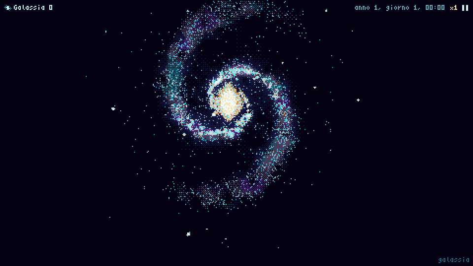
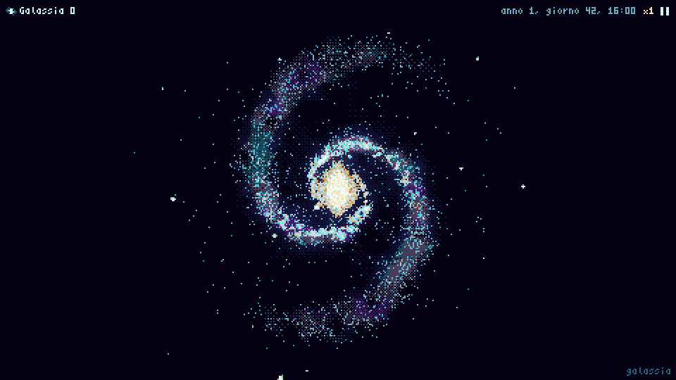
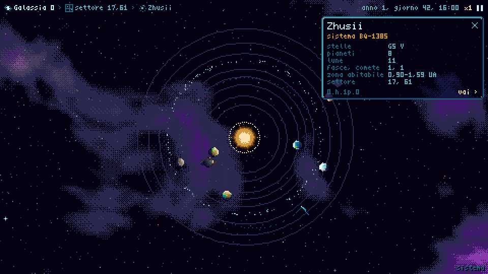
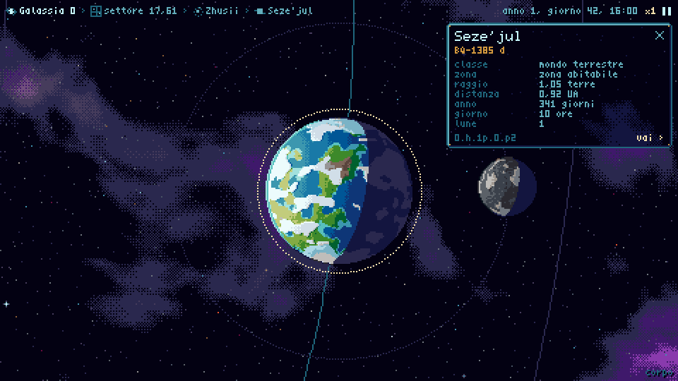
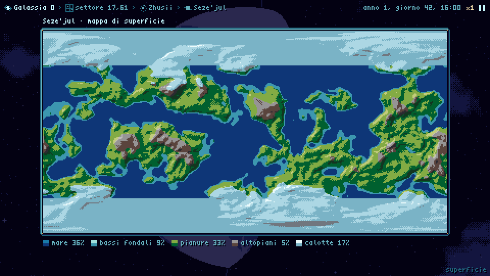
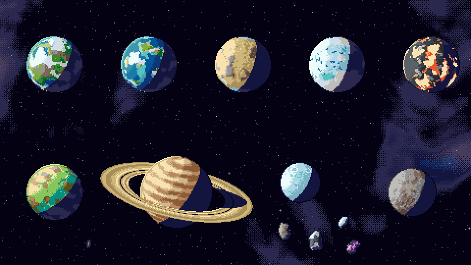
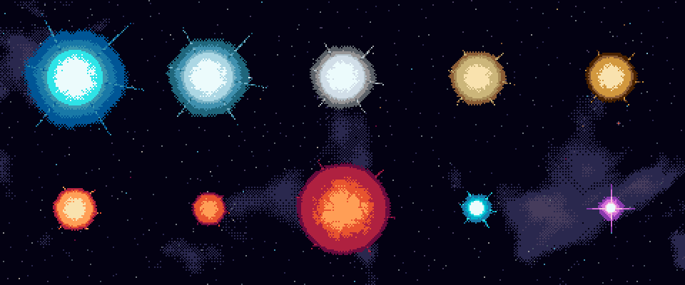

# spatialengine

A pixel-art universe explorer written in TypeScript in which **every pixel is generated by code**. You move the camera continuously from a whole spiral galaxy down to a region of stars, a single star system, a planet with its moons and rings, and finally the planet's surface map. Orbits, rotations, clouds and day/night terminators move as simulated time passes.

The code uses no sprites, image assets or hand-drawn pixel grids. There are only **generators** (algorithms) and **recipes** (JSON parameters), and the only hand-written pixels are the glyphs of the bitmap fonts. The same code runs in the browser and in Node, and it produces the same bytes in both. Every image in this README was rendered by the project's own CLI.



## What's in it

| | |
|---|---|
|  |  |
|  |  |

- **An explorer in the browser**: a 480×270 indexed framebuffer, upscaled by an integer factor. It has five zoom levels (galaxy, region, system, body, surface) that are chosen by on-screen size, so there is no mode switch. It holds 60 fps while zooming from the galaxy down to a planet's surface, because sprites are generated in a pool of Web Workers and cached.
- **A deterministic universe**: a finite galaxy on an unbounded grid of sectors, with spiral arms, an optional bar, a core, voids and clusters. The default galaxy (seed 0) has about 145,000 star systems. Systems can have single, binary or triple stars, planets chosen by orbital zone, moons, rings, asteroid belts and comets on eccentric orbits. Every object gets a generated name and catalogue code, such as `Zhusii (BQ-1385)`, and an address.
- **Procedural pixel-art generators**, each one versioned:
  - `planet@2`: nine archetypes (terran, ocean, desert, ice, lava, toxic, gas giant, cratered, dead) with rotating surfaces, clouds, atmosphere rims, rings and level of detail from 8 to 256 px;
  - `surface@1`: the equirectangular surface map of the same planet, with shaded relief and a legend;
  - `star@1`: ten spectral classes (O to M, white dwarf, red giant, neutron star) with granulation, limb darkening and a palette-cycled corona;
  - `asteroid@1`: rocky, metallic, icy and crystalline bodies that rotate;
  - `background@1`: an infinite, seamless background split into chunks, with nebulae, three parallax layers of twinkling stars and distant galaxies.
- **A pixel-art pipeline**: a 63-colour master palette built from OKLCH ramps with hue shifting, quantised lighting from each body's own star, Bayer dithering anchored to the object, selective outlines in the darkest tone of the material, and cleanup passes for pixel-perfect lines.
- **An interface drawn by code**: procedural 9-slice panels, icons built from primitives, 3×5 and 5×7 bitmap fonts, breadcrumbs, an info card for the selected object, search, a clock and a debug overlay.
- **`forge`**, a CLI for looking at the output: renders, 64-seed contact sheets, parameter sweeps, animations, galaxy and system maps, statistical censuses, golden tests, and explorer views rendered headlessly with the same renderer as the app.





## Getting started

Requirements: Node.js ≥ 20.19 and npm.

```sh
npm install
npm run dev        # the explorer, served by Vite
npm run build      # production build into dist/
npm run check      # typecheck + lint + tests
```

The interface, the CLI output and the design documents are written in Italian.

### Controls

| Input | Action |
|---|---|
| Drag, arrow keys, WASD | Pan |
| Mouse wheel, `+` / `−`, Q / E | Zoom, centred on the cursor |
| Click | Select an object |
| Double-click, Enter, Z | Fly to the selection |
| F | Follow the selected body |
| G, Home | Back to the whole galaxy |
| Esc | Deselect, or go up one level |
| `/`, Ctrl+K | Search by name, catalogue code (`KX-4471`) or address |
| 1–5, `,` / `.` | Time speed: ×1, ×10, ×100, ×1000, ×10 000 ticks per second |
| Space | Pause |
| T | Switch between a dithered cross-fade and a hard cut between sprite sizes |
| H, `?` | Help |
| F3 | Debug overlay: fps, render time, sprite cache, worker queue, generation times |

The URL follows the view and restores it on load: `?a=<address>&z=<zoom>&t=<tick>`. Adding `&debug` opens the overlay.

### Addresses

Every place in the universe has a stable address:

```
<galaxy>[.<sx>.<sy>[.<system>[.<body>]]]
```

The galaxy, sector coordinates and system index are written in base 36. A body is `s<k>` for a star, `p<n>` for a planet, `p<n>m<k>` for a moon, `a<k>` for an asteroid belt and `c<k>` for a comet. Indices start at 0. For example, `0.h.1p.0.p2` is Seze'jul (BQ-1385 d), a terran planet in the habitable zone of the Zhusii system in galaxy 0.

Time is an integer tick, where one tick is one hour and a year is 8,766 ticks. The state at any tick is computed directly from the tick, with no incremental simulation, so jumping through time costs nothing and a link that includes a tick always reproduces the same view.

## The forge CLI

```sh
npm run forge -- list                                   # generators, versions and recipe parameters
npm run forge -- render planet --seed 7 --scale 4 --bg  # one object as a PNG, plus its descriptor
npm run forge -- sheet planet --bg                      # 64 consecutive seeds on one sheet
npm run forge -- params planet --param archetype --values terran,ice,lava,gas --seeds 0..7 --bg
npm run forge -- anim star --bg --strip                 # a looping GIF and a strip of its frames
npm run forge -- galaxy                                 # the whole galaxy, one pixel per sector
npm run forge -- systems                                # a sheet of random systems, with addresses
npm run forge -- system 0.h.1p.0 --tick 1000            # top-down view of one system at a tick
npm run forge -- view 0.h.1p.0.p2 --zoom body           # an explorer frame rendered in Node
npm run forge -- census                                 # universe statistics against expected ranges
npm run forge -- golden check                           # has any generator's output changed?
npm run forge -- help <command>                         # all options of a command
```

All output goes to `out/`, which is ignored by git. Images are written at integer scale with no interpolation. `--bg` draws the space background instead of transparency.

The images in this README live in `docs/images/` and were made with `view` (the explorer shots and the zoom GIF) and `scene` (the planet and star plates, from `recipes/scenes/readme-*.json`).

## Determinism

The pure modules (`core/`, `toolkit/`, `gen/`, `universe/`, `view/`) follow strict rules so that the same input produces the same bytes on every JavaScript engine:

1. A generator is a pure function: the same recipe, seed, options and frame always give the same bytes.
2. No `Math.random`, `Date` or `performance.now`.
3. Seeds are derived by hashing with a name, as in `derive(seed, "clouds")`, so adding a feature never shifts the others.
4. Noise is a hash of integer lattice coordinates, with no shuffled permutation tables, so any point can be computed on its own over an unbounded domain.
5. No transcendental `Math` functions (`sin`, `cos`, `atan2`, `exp`, `log`, `pow`, `**`…). Their precision is implementation-defined, and a difference in the last bit near a threshold changes a pixel. `core/dmath` rebuilds them from `+ - * /` and `Math.sqrt` alone, which IEEE 754 rounds correctly everywhere.
6. Time is an integer tick, never wall-clock seconds.
7. Output is a buffer of palette indices; conversion to RGBA happens only at the very end.
8. Every generator is versioned (`planet@2`), and golden fingerprints catch any unintended change in output.
9. Iteration happens only over arrays or sorted keys.

ESLint enforces most of these rules, along with the allowed dependencies between modules. `tsconfig.pure.json` gives the pure modules no DOM or Node types. The pure modules have no npm dependencies.

## Project layout

```
core/       hashing and seed derivation, RNG, deterministic math, noise, indexed buffers, fingerprints
toolkit/    colour spaces, palette and index tables, lighting, dithering, shading, outlines, cleanup, fonts
gen/        generator registry and recipe schema; planet, surface, star, asteroid, background; map drawing
universe/   galaxy shape and sectors, stars, systems, orbits, names, addresses, census
view/       the explorer without a browser: camera, zoom levels, sprite cache, world, flights, UI
app/        the explorer in the browser: canvas, input, main loop, URL, worker pool
forge/      the CLI, golden tests, palette builder, benchmarks
style/      palette ramps (ramps.json) and the generated 63-colour palette (palette.json)
recipes/    planet presets and scenes (JSON)
tests/      golden fingerprints for the core, the universe, the views and each generator
docs/       DESIGN.md (the full design and every decision), implementation plans, README images
```

Allowed dependencies: `core` ← `toolkit` ← `gen` ← `view`, and `core` ← `universe`. `gen` and `view` may read from `universe`. Only `forge/` and `app/` use npm packages.

## Stack

TypeScript 6 (strict, ESM), Vite 8, Vitest 4, ESLint 10 with typescript-eslint, and tsx for the CLI. `forge` uses `pngjs` and `gifenc` to write images. The browser app has no runtime dependencies.

## License

[PolyForm Noncommercial 1.0.0](LICENSE.md). You may use, study, modify and share the code for any non-commercial purpose, such as personal projects, research, education and hobby work. Commercial use is not permitted.
